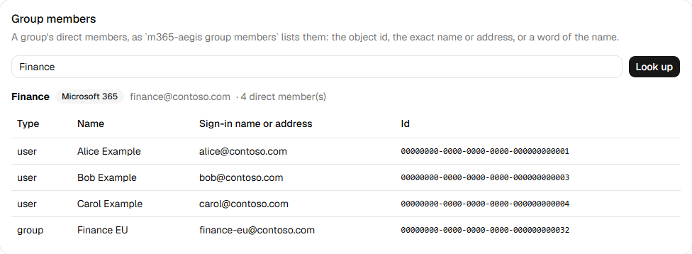

# m365-aegis

[](https://github.com/speti4/m365-aegis/actions/workflows/ci.yml)
[](https://github.com/speti4/m365-aegis/releases/latest)
[](LICENSE)

A thin Microsoft 365 operations layer for Windows 11, for a Microsoft 365 administrator and the support team they hand
tasks to: one sign-in for Microsoft Graph and Exchange Online, a command line whose answers a shell, a script or an
agent can parse, and a window with guided task cards. Groups, Teams and SharePoint; Exchange Online mailboxes; audit,
sign-ins and reports. Every write behind a plan and a confirmation.

## What it does

- **One sign-in.** The Windows account manager signs you in with the account you already use (silently on an
  Entra-joined machine), and the same sign-in serves Microsoft Graph and Exchange Online.
- **Graph without the module import.** A direct client: paging, throttling and batching handled once, v1.0 by default
  and `--beta` when needed, plus a raw `call` for any endpoint.
- **Exchange Online included.** Mailbox permissions, forwarding, shared mailboxes, calendars and sizes through the
  Exchange Online Admin API and a long-lived PowerShell sidecar running `ExchangeOnlineManagement` with a cmdlet
  allow-list; message trace through Graph.
- **Two outputs, one contract.** A table at a terminal, a JSON envelope in a pipe or for an agent; exit codes that mean
  one thing each.
- **Writes behind a plan.** Group members and owners, mailbox rights and forwarding, one at a time or from a CSV file:
  `--dry-run` shows the plan, `--yes` applies it, and every apply leaves a record that `--resume` can continue.
- **Snapshots.** Who can reach what (groups, sites, shared files, mailboxes, calendars) read into one local file, so
  `access <user>` answers in under a second without signing in, and `snapshot diff` shows who gained or lost access
  between two of them.
- **A window for the team.** Task cards for the daily Exchange and group work the admin centers make slow, each write
  ending in a confirmation.

What it prints, against a made-up tenant:

```text
> m365-aegis group owners-missing
name             type           address              id
---------------  -------------  -------------------  ------------------------------------
Helpdesk Admins  security       -                    00000000-0000-0000-0000-000000000034
Project Phoenix  Microsoft 365  phoenix@contoso.com  00000000-0000-0000-0000-000000000033

2 group(s) without an owner
3 distribution, mail-enabled security or synced group(s) left out: Graph keeps no owners for them (--all-types lists them)

> m365-aegis group owners Finance --json
{"ok":true,"data":{"group":{"id":"00000000-0000-0000-0000-000000000031","displayName":"Finance","kind":"microsoft365","mail":"finance@contoso.com","synced":false},"owners":[{"type":"user","displayName":"Alice Example","userPrincipalName":"alice@contoso.com","mail":"alice@contoso.com","id":"00000000-0000-0000-0000-000000000001"}]},"meta":{"requestIds":["00000000-0000-0000-0000-0000000000e1","00000000-0000-0000-0000-0000000000e5"],"elapsedMs":412,"backend":"graph"}}
```

And the window's group members card, over the same made-up tenant:



## Install

1. Download `m365-aegis-<version>.zip` and `SHA256SUMS.txt` from the
   [latest release](https://github.com/speti4/m365-aegis/releases/latest).
2. Check the checksum: `(Get-FileHash .\m365-aegis-<version>.zip).Hash` matches `SHA256SUMS.txt`.
3. Check the build: `gh attestation verify .\m365-aegis-<version>.zip --repo speti4/m365-aegis`.
4. `Unblock-File .\m365-aegis-<version>.zip`, then extract it into a folder of your own.
5. Run `.\m365-aegis.exe doctor --offline` there: it says what the machine still needs (the .NET 10 Desktop Runtime,
   PowerShell 7.6 and the `ExchangeOnlineManagement` module).

The [usage guide](docs/usage.md#before-the-first-start) has the details, and what the doctor's `signature` row means on
your machines.

## Set up your tenant

There is no shared client id: every tenant registers its own public client of m365-aegis once, and consents to the
delegated permissions its team will use. The [setup guide](docs/setup.md) walks the administrator through the
registration, the permissions table, the consent and the first sign-in.

## Use it

```powershell
m365-aegis login --tenant contoso.onmicrosoft.com --client-id <application id> --account alice@contoso.com
m365-aegis mailbox access finance@contoso.com
m365-aegis group members add Finance dave@contoso.com --dry-run
```

`m365-aegis-gui.exe` opens the window, with the same sign-in and plans and cards for the sign-in, group members,
mailbox access, mailbox rights and mailbox forwarding. The [usage guide](docs/usage.md) covers every command and card.

## Documentation

| document | for |
| --- | --- |
| [Setup guide](docs/setup.md) | the administrator: the app registration, the permissions, the consent, handing it to the team (shipped in the zip as `SETUP.md`, next to `README.txt` and `LICENSE.txt`) |
| [Usage guide](docs/usage.md) | everyone who uses it: the download, the sign-in, every command and card, the doctor, the exit codes (shipped in the zip as `GUIDE.md`) |
| [Security policy](SECURITY.md) | verifying a release, reporting a vulnerability, what is in scope |
| [Contributing](CONTRIBUTING.md) | building from source, the checks before a commit, the project rules |
| [Development](docs/development.md) | how it works inside: the layout, the sign-in, the Exchange Online layers, the writes, CI and releases |
| [Decisions](tasks/decisions/) | why it is built the way it is: the stack, the sign-in, Exchange Online, the output contract, the signing |
| [Changelog](CHANGELOG.md) | what each release changed |
| [Releases](https://github.com/speti4/m365-aegis/releases) | the zips, their checksums and release notes |

## Status

Version 0.1.0, for Windows 11 only, under active development: each release adds commands, while the exit codes and the
plan-first rule for writes stay as they are. Next: a snapshot comparison (who gained or lost access since the last one)
and the access view as a card in the window.

## License

[MIT](LICENSE). Microsoft 365, Microsoft Graph, Exchange Online and Entra are Microsoft's; m365-aegis is an
independent tool, not a Microsoft product. The third-party components it ships and their licenses are listed in the
release's `THIRD-PARTY-NOTICES.md`.
